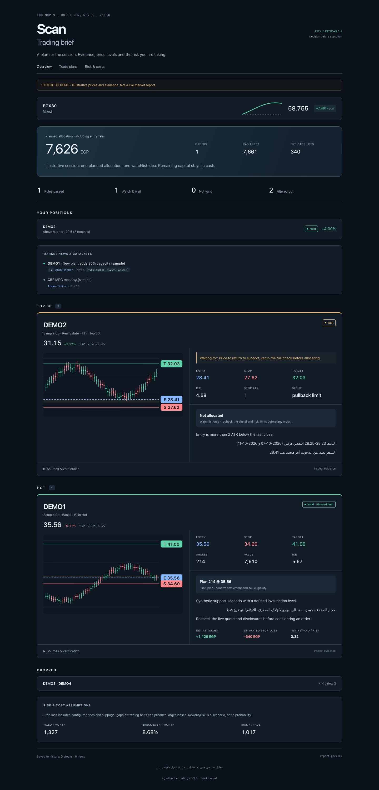
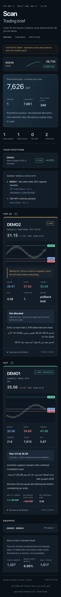

<div align="center">

# EGX ThndrX Trading

**Claude skills that analyse Egyptian Exchange (EGX) stocks inside ThndrX, draw the plan on your chart, check the news, review your positions and hand you a beautiful, evidence-packed HTML report.**

You place every order yourself. The skills only read and draw.


 

</div>

---

## What you get

Two skills:

| Command | What it does |
|---|---|
| **`check COMI`** · `افحص COMI` | Scripted chart analysis (trend daily + weekly, zones with touch dates, RSI + divergence, MACD, ATR, Bollinger squeeze, volume, patterns, relative strength vs EGX30), a plan with entry / stop / target drawn on your ThndrX chart (zone boxes, event lines, MA50 / MA200), dated news from a whitelist of sources, a ✅ / ⏳ / ❌ verdict computed by a script, and the exact order-ticket steps. |
| **`check COMI T0`** | Same-session (T+0) check on 5-minute bars: VWAP, opening range, three setups, no entry after 13:30, exit by 14:10. |
| **`Scan`** · `لف على الـ 30` | Positions review, then three lists: **Top 30**, **Hot** (mergers, acquisitions, tender offers, global demand themes, urgent industry decisions) and **Same day T0** during the session. The full check on the best of each, the **top 3 per list**, and a split of the amount you want to invest with risk, caps and fees. |
| **`my positions`** · `راجع مراكزي` | Every stock you hold gets **hold / tighten stop / sell / add**, with evidence. |
| **`market`**, **`monthly`**, **`اشتريت … / بعت …`**, **`قلت ايه عن HRHO؟`** | Market regime, monthly results vs your fixed costs, trade logging to Google Sheets, and Claude's memory of every past call. |

### Strict by design
**Nothing is skipped (v0.4).** Every command is split into steps and every step into atomic steps (`skills/egx-check/references/steps.json`). `egx.py step` keeps a hash-chained ledger: each atomic step is recorded with its proof, in order, before the next one counts. Most are proven by scripts (receipts, the page script's call log, files); the few only Claude can state are recorded with the value it saw and shown separately. A missing or failed atomic step makes the stock ⏳ and is named in the answer and the report; without a complete ledger there is no report.

Every check passes **8 gates** (including the step ledger). Chart operations carry script receipts; news entries and some workflow steps are supplied by Claude and checked for structure: open → analyse → news → draw → **verify** (the script reads every drawn line back from the chart) → screenshot (its file time must come after the verify) → verdict (computed by `egx.py`; Claude may only downgrade it). A failed gate makes the stock ⏳ and the answer names it.

### Reports and memory
- **One report per run**, HTML and PDF: responsive research brief, TradingView-style charts, news per pick with source tier and date, the gate checklist and the real ThndrX screenshot. Saved in your reports folder and uploaded to your **Google Drive** folder (the PDF opens in Drive on any phone).
- **Memory for Claude**: `history.jsonl`, `news.jsonl` and `runs.jsonl` next to the reports. "What did you say about HRHO?" costs about 120 tokens per past call (`egx.py recall HRHO`), outcomes are recorded when targets or stops are hit, and cached news is reused while new disclosures and corrections are searched.

Reports are named `EGX_<Command>_<YYYY-MM-DD>_<HH-MM>`.

## Review and report preview (v0.5)

[Open the synthetic report preview](examples/report-preview.html) · [Deep review and remaining limitations](docs/REVIEW.md)

Only valid signals receive an allocation. Wait signals stay on the watchlist. Swing and T0 plans share cash and exposure limits; sizing includes fees and configured stop slippage. The report shows planned allocations, scenario losses, and expandable evidence on desktop and mobile. No strategy profitability has been established by these software tests.

## Quick start

```bash
git clone https://github.com/tarekfouad97/egx-thndrx-trading.git
cd egx-thndrx-trading
```
- **macOS**: double-click `Install-Mac.command` (or `bash install.sh`)
- **Windows**: double-click `Install-Windows.bat`

The installer installs Python if needed, asks a few settings, creates your reports folder and builds `dist/egx-thndrx-trading.plugin`. Drag that file into the Claude app, install [Claude in Chrome](https://claude.ai/chrome), sign in to [ThndrX](https://x.thndr.app) in Chrome, and say **`check COMI`**.

Full guide: **[docs/SETUP.md](docs/SETUP.md)** · Phone: **[docs/PHONE.md](docs/PHONE.md)** · Internals: **[docs/HOW-IT-WORKS.md](docs/HOW-IT-WORKS.md)**

## Why it is fast and cheap on tokens

Claude does not eyeball charts or work out levels in its head:

- **`egx_chart.js`** runs inside the ThndrX tab. It opens tickers through the search box, reads 300 daily bars (or today's 5-minute bars) from the chart's own `exportData()`, computes every indicator and the plan, draws the marks and verifies them. It returns **one line per stock** and scans 8 stocks per call. It is cached in the tab, so later sessions load it with one line.
- **`egx.py`** (Python standard library only) computes the verdicts and rankings, the sizing, caps, Thndr fees, monthly break-even, the report and PDF, and Claude's memory files.

The rules are written down in [`analysis-rules.md`](skills/egx-check/references/analysis-rules.md) and the news sources in [`news-sources.md`](skills/egx-check/references/news-sources.md), so every verdict can be explained.

## Safety

- **Never trades**: no buy / sell / confirm / modify / cancel clicks, nothing typed in the order ticket.
- **Read-only** on your account; draws only its own `EGX·` chart lines.
- **No login work** and **no private API calls**, only what ThndrX shows.
- **Proof or "unknown"**: every step has a script receipt, levels carry bar dates, news comes from whitelisted sources with link and date.
- **Education, not investment advice.** Your money, your decisions.

## Repository layout

```
.claude-plugin/plugin.json          plugin manifest
skills/
  egx-check/                        check (swing + T0), market, positions, log, monthly, memory
    SKILL.md
    config.example.json             copied to config.json by the installer (git-ignored)
    scripts/egx_chart.js            in-page analysis, drawing and verify (source)
    scripts/egx_chart.loader.js     minified, self-caching build
    scripts/build_loader.py
    scripts/egx.py                  verdict, check, allocate, report, fees, memory, drive-record
    scripts/egx_gates.py            the 8 gates and the verdict rules
    scripts/egx_steps.py            the atomic-step ledger (egx.py step ...)
    references/steps.json           every command as steps and atomic steps
    scripts/egx_page.py             the report page (HTML, PDF)
    scripts/egx_memory.py           history / news / runs .jsonl and recall
    scripts/egx_report.py           the HyperFrames recap video
    references/                     analysis rules, run-file schema, news sources, ThndrX UI notes
  egx-scan/                         Scan: Top 30, Hot, Same day T0
    SKILL.md
    references/themes.md            global-demand themes mapped to EGX sectors
templates/EGX_Trade_Log_template.xlsx   blank trade log for Google Sheets
examples/sample-run.json            synthetic run used by the tests and screenshots
tests/                              node + python tests
docs/                               design, setup, phone, how it works
install.py · install.sh · install.ps1 · Install-Mac.command · Install-Windows.bat
```

## Development

```bash
node tests/test_chart.js                 # chart analysis on synthetic series
node tests/test_chart_draw.js            # drawing, verify and T0 with a mocked chart
python3 tests/test_risk.py               # risk limits and report trust boundaries
python3 tests/test_egx.py                # step ledger, gates, verdicts, ranking, sizing, report, memory, Drive plan
python3 skills/egx-check/scripts/build_loader.py   # after editing egx_chart.js (bump VERSION)
python3 install.py --build-only          # rebuild dist/
```
The design and the reasons behind it: [docs/DESIGN.md](docs/DESIGN.md).

---

<div align="center">

Made with ❤️ by **Tarek Fouad** · [tare2fo2ad@gmail.com](mailto:tare2fo2ad@gmail.com) · [github.com/tarekfouad97/egx-thndrx-trading](https://github.com/tarekfouad97/egx-thndrx-trading)

<sub>Not affiliated with Thndr, EGX or Anthropic. Analysis, not investment advice.</sub>

</div>
